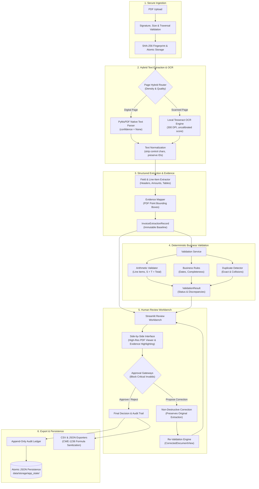

# DocuMind — Intelligent Invoice Extraction & Verification System

[](https://www.python.org/)
[](LICENSE)
[](https://github.com/ThunderSkull7/DocuMind/actions/workflows/ci.yml)
[](#7-automated-tests--code-quality)
[](#7-automated-tests--code-quality)
[](#4-system-architecture)

> **Intelligent Invoice Extraction & Verification** — A local-first document processing system combining PDF text extraction, OCR fallback, structured data extraction, business rule validation, spatial evidence mapping, and human-in-the-loop review.

---

## 1. Introduction

Manual invoice processing is notoriously labor-intensive, error-prone, and slow. Accounts payable teams frequently struggle with invoices received across heterogeneous formats—from clean digital PDFs with embedded vector text to poorly scanned, skewed image documents.

Standard Optical Character Recognition (OCR) alone is insufficient for reliable invoice processing:
- OCR outputs unstructured raw text or disjointed word tokens without semantic business meaning.
- Layout heuristics break on multi-column headers, non-standard tax presentations, or rotated text.
- General-purpose LLMs hallucinate financial amounts or struggle with exact coordinate provenance.
- Sending proprietary financial invoices to third-party cloud APIs introduces regulatory and data-privacy risks.

**DocuMind** solves this by providing a local-first, modular processing pipeline:
1. **Deterministic Hybrid Routing**: Fast C-level native vector PDF parsing with automated fallback to local Tesseract OCR for image-only scans.
2. **Coordinate Grounding**: Every extracted header, financial amount, and line item is anchored to standard PDF point coordinates (`[x0, y0, x1, y1]`).
3. **Fixed-Point Business Validation**: Deterministic arithmetic consistency checks using Python's `Decimal` to ensure line-item sums and tax equations balance with zero floating-point drift.
4. **Human-in-the-Loop Review**: An interactive Streamlit workbench with dynamic high-resolution bounding-box overlays, non-destructive field corrections, and optimistic concurrency locking.
5. **Privacy by Design**: 100% local processing on host hardware without external cloud transmissions.

DocuMind serves as a capstone portfolio project demonstrating production-grade software engineering, applied AI document processing, and verifiable audit workflows.

---

## 2. Key Features

1. **Secure Document Ingestion**: Multi-gate validation checking `%PDF-` binary signatures, file size bounds ($\le 25\text{ MB}$), page limits ($\le 100$), encryption policy, and SHA-256 fingerprinting.
2. **Native PDF Text Extraction**: High-fidelity text, word token, and reading-order extraction via PyMuPDF C-bindings ($28\text{ ms}$ average latency).
3. **Local Tesseract OCR Fallback**: Automated page-level hybrid routing for scanned documents with 300 DPI in-memory rasterization and pixel-to-point coordinate projection.
4. **Structured Invoice Field Extraction**: Rule-based extraction of invoice identifiers, dates, vendor names, currency, and financial summaries.
5. **Spatial Evidence Mapping**: Bidirectional coordinate mapping linking every extracted field to its physical bounding box on the original document.
6. **Monetary & Date Normalization**: Converts diverse international notations (e.g. `USD 1,234.56` and `1.234,56 €`) into exact `Decimal` objects; flags ambiguous dates (e.g. `03/04/2024`) with candidate interpretations.
7. **Business Rule & Arithmetic Validation**: Deterministic validation verifying line-item sums, subtotal + tax = total equations, future date caps, and mandatory completeness.
8. **Multi-Tier Duplicate Screening**: Detects exact file hash collisions, duplicate invoice numbers for the same vendor, and cross-vendor collisions.
9. **Reference Matching**: Reconciles extracted vendor names and purchase order references against reference datasets.
10. **Human Review & Non-Destructive Corrections**: Accounts payable workbench allowing reviewers to inspect evidence and propose corrections while preserving original extraction records.
11. **Approval Gates & Revision Locking**: Blocks approval for invoices with critical missing fields or unresolved discrepancies; uses optimistic locking (`revision_id`) to prevent concurrent edit overwrites.
12. **Auditable Reporting & CWE-1236 Defense**: Tabular CSV and JSON exports equipped with formula-injection sanitization to protect spreadsheet users.
13. **Atomic JSON Persistence & Crash Recovery**: State persists locally via atomic file replacement (`.tmp` + `os.replace`); corrupted snapshots are automatically backed up to `.corrupted_<timestamp>` for forensics without crashing.

---

## 3. System Architecture

DocuMind implements an end-to-end modular monolith architecture with strict data isolation between raw extractions, business validation findings, and human review corrections:



---

## 4. Technology Stack

| Layer | Technology | Primary Purpose |
| :--- | :--- | :--- |
| **Language & Runtime** | **Python 3.12** (3.10–3.12 supported) | Primary language for pipeline execution |
| **PDF Processing** | **PyMuPDF** (`pymupdf>=1.24.0`) | High-fidelity vector parsing & page rasterization |
| **OCR Engine** | **Tesseract OCR 5.4.0** (`pytesseract>=0.3.10`) | Offline OCR recognition for scanned documents |
| **Image Processing** | **Pillow** (`Pillow>=10.0.0`) | Image manipulation, deskewing & evidence overlays |
| **Data Validation** | **Pydantic v2** (`pydantic>=2.7.0`) | Strict schemas, field typing, and serialization |
| **Tabular Data** | **pandas** (`pandas>=2.2.0`) | Data transformation and reporting matrices |
| **Web Presentation** | **Streamlit** (`streamlit>=1.35.0`) | Multipage interactive AP review workbench |
| **Automated Testing** | **pytest** & **pytest-cov** | Unit, property, and integration test execution |
| **Code Quality** | **Ruff** (`ruff>=0.4.0`) | Fast linter and code formatter |

---

## 5. Repository Structure

```text
DocuMind/
├── .github/
│   ├── workflows/ci.yml             # GitHub Actions CI matrix (Python 3.10, 3.11, 3.12 + OCR)
│   ├── ISSUE_TEMPLATE/              # Bug report and feature request forms
│   └── pull_request_template.md     # Pull request verification checklist
├── app/
│   ├── Home.py                      # Streamlit application landing hub & diagnostics
│   ├── components/
│   │   └── pdf_viewer.py            # High-DPI PDF rasterizer with bounding-box highlight overlays
│   ├── services/
│   │   └── state.py                 # Thread-safe singleton coordinator & atomic JSON persistence
│   └── pages/
│       ├── 01_Dashboard.py          # Operational AP dashboard & discrepancy analytics
│       ├── 02_Upload_Invoices.py    # Multi-file secure upload & processing portal
│       ├── 03_Document_Explorer.py  # Filterable invoice registry with detail drawers
│       ├── 04_Review_Workbench.py   # Split-screen PDF evidence viewer & review editor
│       ├── 05_Validation_Reports.py # Business rule catalogue hit rates
│       ├── 06_Audit_History.py      # Immutable event stream & actor attribution
│       └── 07_Settings.py           # Environment diagnostics, corpus loader, batch exports
├── data/
│   ├── annotations/                 # 50 gold-standard ground truth JSON annotations
│   ├── synthetic_documents/         # 50 synthetic benchmark PDFs (30 digital, 20 scanned)
│   └── manifest.json                # Complete catalog of synthetic benchmark documents
├── docs/
│   ├── architecture.md              # Detailed subsystem architecture and data models
│   ├── document_schema.md           # Pydantic schema specifications and evidence models
│   ├── evaluation.md                # Evaluation framework and benchmark methodology
│   ├── privacy_and_security.md      # Security and data protection policies
│   ├── user_guide.md                # Operator walkthrough and review procedures
│   └── decisions/                   # 8 Architecture Decision Records (ADRs 0001–0008)
├── reports/
│   ├── DOCUMIND_FINAL_TECHNICAL_AUDIT.md  # Comprehensive technical lifecycle audit
│   ├── DOCUMIND_FINAL_EVALUATION.md       # Multi-tier evaluation benchmark report
│   ├── DOCUMIND_SECURITY_REVIEW.md        # Focused security and privacy review
│   └── DOCUMIND_PUBLICATION_READINESS.md  # 5-level operational readiness assessment
├── scripts/
│   ├── evaluate_extraction.py       # Benchmark evaluation script across 50 documents
│   └── benchmark_performance.py     # Empirical latency and memory measurement script
├── src/documind/
│   ├── config.py                    # Environment settings and path management
│   ├── logging.py                   # PII-safe structured logging
│   ├── exceptions.py                # Hierarchical exception taxonomy
│   ├── dataset/                     # Synthetic invoice generation and models
│   ├── ingestion/                   # Gated validation and atomic storage
│   ├── extraction/                  # Hybrid text extraction, OCR, structured parsers
│   ├── schemas/                     # Canonical Pydantic invoice models
│   ├── validation/                  # Business rules, arithmetic, duplicate screening
│   ├── review/                      # State machine, corrections, revision locking, audit
│   └── reporting/                   # CSV and JSON exporters with CWE-1236 sanitization
├── tests/
│   ├── integration/                 # End-to-end workflow, OCR, and corpus tests
│   └── unit/                        # Unit tests & property-based invariant tests
├── CONTRIBUTING.md                  # Development guidelines and coding standards
├── LICENSE                          # MIT License
└── pyproject.toml                   # Project metadata, dependencies, and tool settings
```

---

## 6. Installation & Local Setup

### 6.1 Windows PowerShell Setup

```powershell
# 1. Clone repository
git clone https://github.com/ThunderSkull7/DocuMind.git
cd DocuMind

# 2. Create virtual environment
python -m venv venv
.\venv\Scripts\Activate.ps1

# 3. Install editable package with dev dependencies
pip install -e ".[dev]"

# 4. Copy configuration template
cp .env.example .env
```

#### Tesseract OCR Configuration (Windows)
For scanned document OCR fallback:
1. Download and install [Tesseract OCR for Windows](https://github.com/UB-Mannheim/tesseract/wiki).
2. Configure your Tesseract path in `.env` (example default installation path):
   ```bash
   DOCUMIND_TESSERACT_CMD="C:\Program Files\Tesseract-OCR\tesseract.exe"
   ```
*Note: Digital vector PDFs process with 100% fidelity without Tesseract; scanned PDFs automatically utilize Tesseract when configured.*

### 6.2 Linux / Ubuntu Setup

```bash
# 1. Install system dependencies (Tesseract OCR and English language data)
sudo apt-get update
sudo apt-get install -y tesseract-ocr tesseract-ocr-eng

# 2. Clone repository & create virtual environment
git clone https://github.com/ThunderSkull7/DocuMind.git
cd DocuMind
python3 -m venv venv
source venv/bin/activate

# 3. Install dependencies
pip install -e ".[dev]"
cp .env.example .env
```

---

## 7. Application Usage Workflow

1. **Launch Application**:
   ```powershell
   streamlit run app/Home.py
   ```
   Open your browser at `http://localhost:8501`.
2. **Preload Sample Data or Upload**:
   - On the **Home** page or **Settings** page, click **"Load 10 Sample Invoices"** to immediately explore the system.
   - Alternatively, navigate to **Upload Invoices** to upload single or multi-page invoice PDFs.
3. **Explore Document Registry**:
   - Inspect invoices in **Document Explorer**, filtering by review status or searching by vendor name.
4. **Interactive Review Workbench**:
   - Navigate to **Review Workbench**.
   - Select any extracted field in the right panel to dynamically highlight its physical bounding box on the left-side high-resolution PDF preview.
   - Inspect discrepancies flagged by the deterministic validation engine (e.g. arithmetic mismatches, missing numbers).
5. **Propose Non-Destructive Corrections**:
   - Propose field corrections with mandatory reviewer rationales. Accepted corrections trigger re-validation, updating the document status from `NEEDS_REVIEW` to `VALID`.
6. **Approve / Reject with Revision Locking**:
   - Invoices with critical missing fields cannot be approved until corrected.
   - Approved or rejected decisions are locked and permanently recorded in the append-only **Audit History**.
7. **Export Sanitized Reports**:
   - Download CSV or JSON summaries on the **Settings** page with built-in CWE-1236 formula-injection protection.

For comprehensive operational guidelines, consult the [Operator User Guide](docs/user_guide.md).

---

## 8. Benchmark Evaluation & Results

Empirically evaluated against the reproducible 50-document synthetic invoice corpus (30 digital vector PDFs, 20 scanned image PDFs) with explicit ground truth denominators:

### 8.1 Field Extraction Precision, Recall & F1 Matrix

| Canonical Field | Ground Truth Present | Extracted (TP) | Ground Truth Missing | Detected Missing (TN) | Ambiguous Flagged | Precision | Recall | F1 Score |
| :--- | :---: | :---: | :---: | :---: | :---: | :---: | :---: | :---: |
| **Invoice Number** | 48 | 48/48 | 2 | 2/2 | 0 | **100.0%** | **100.0%** | **100.0%** |
| **Invoice Date** | 50 | 49/50 | 0 | 0/0 | 1 | **100.0%** | **100.0%** | **100.0%** |
| **Vendor Name** | 49 | 49/49 | 1 | 1/1 | 0 | **100.0%** | **100.0%** | **100.0%** |
| **Document Currency** | 50 | 50/50 | 0 | 0/0 | 0 | **100.0%** | **100.0%** | **100.0%** |
| **Subtotal Amount** | 50 | 50/50 | 0 | 0/0 | 0 | **100.0%** | **100.0%** | **100.0%** |
| **Tax Amount** | 48 | 48/48 | 2 | 2/2 | 0 | **100.0%** | **100.0%** | **100.0%** |
| **Total Amount** | 50 | 50/50 | 0 | 0/0 | 0 | **100.0%** | **100.0%** | **100.0%** |

> [!IMPORTANT]
> **Synthetic Benchmark Context**: All performance figures were evaluated on the 50-document synthetic invoice corpus (`data/synthetic_documents/`). These results demonstrate deterministic rule correctness, coordinate grounding, and edge-case handling on this corpus; they are **not guarantees of universal accuracy across unconstrained real-world invoice layouts**.
>
> **OCR Confidence Semantics**: Confidence scores reported for OCR tokens represent uncalibrated heuristic scores provided directly by Tesseract OCR; no empirical statistical calibration has been performed.

### 8.2 Subsystem Performance by Document Format

| Metric / Dimension | Digital Invoices (30 docs) | Scanned Invoices (20 docs) | Overall Benchmark (50 docs) |
| :--- | :---: | :---: | :---: |
| **Routing Accuracy** | 30/30 (100.0%) | 20/20 (100.0%) | 50/50 (100.0%) |
| **Total Line Items Extracted** | 60 items | 40 items | 100 items |
| **Evidence Box Validity** | 100.0% (348/348) | 100.0% (232/232) | 100.0% (580/580) |
| **Pydantic Schema Pass** | 28/30 (93.3%) | 19/20 (95.0%) | 47/50 (94.0%)* |
| **Mean End-to-End Latency** | **33.41 ms** (~30 docs/sec) | **1004.90 ms** (~1 s/doc) | **21.11 s** total batch |

*\*The 3 documents failing Pydantic schema validation (`DOC-SYN-007`, `DOC-SYN-018`, `DOC-SYN-035`) are intentional negative test cases designed to evaluate mandatory field completeness.*

---

## 9. Automated Tests & Code Quality

DocuMind maintains a comprehensive test suite covering unit, property invariant, and integration layers:

```powershell
# Run the complete test suite (175 tests)
pytest -v

# Run tests with source code coverage
pytest -v --cov=src/documind --cov-report=term-missing

# Run Ruff linter and formatting checks
ruff check .
ruff format --check .

# Run the 50-document extraction & business validation benchmark
python scripts/evaluate_extraction.py

# Run empirical performance measurement script
python scripts/benchmark_performance.py
```

### Verified Test Summary
- **175 automated tests passing** across unit, property-based, and integration tiers.
- **89% source code coverage** across `src/documind`.
- **Zero Ruff errors or formatting discrepancies** across 125 files.

---

## 10. Security & Privacy Posture

- **100% Local Execution**: All PDF rendering, OCR extraction, field extraction, business validation, and reporting execute entirely on localhost. Zero data is transmitted to external cloud APIs.
- **CSV Formula Injection Sanitization (CWE-1236)**: Every tabular export string starting with dangerous trigger characters (`=`, `+`, `-`, `@`, `\t`, `\r`, `%`) is prepended with a single quote (`'`), neutralizing spreadsheet formula exploits.
- **Path Traversal Defense (CWE-22)**: Document storage utilizes isolated UUIDv4 directories and strict path validation.
- **PII-Safe Logging**: Structured logging automatically scrubs monetary amounts, invoice numbers, and vendor names unless `DOCUMIND_LOG_PII=true` is explicitly enabled.
- **Zero Hardcoded Secrets**: Repository contains zero hardcoded API keys, passwords, or tokens.

For complete architectural security evaluations, consult the [Security Review Report](reports/DOCUMIND_SECURITY_REVIEW.md).

---

## 11. Known Limitations

In the interest of engineering transparency, the following scope boundaries and limitations apply:
1. **Invoice Family Focus**: The extractor is optimized for standard commercial invoice structures and does not process general unstructured contracts, medical records, or receipts.
2. **Synthetic Corpus Scope**: Tested thoroughly on a 50-document synthetic corpus with 5 layout families. Real-world invoices with novel handwritten notes or complex multi-column wraps will require expanded layout rules.
3. **Uncalibrated OCR Confidence**: Tesseract OCR engine confidence scores are heuristic and uncalibrated.
4. **Local JSON Persistence**: App state is persisted via atomic local JSON files (`data/storage/app_state/`). It is designed for single-operator local evaluation and workstation use, not high-concurrency multi-tenant operations.
5. **No Built-in Authentication / RBAC**: The local Streamlit interface assumes single-user or internal network access.
6. **No Hardware Sandboxing**: PDF C-engine parsing (PyMuPDF) executes locally as an unprivileged process without container or hardware seccomp isolation.

---

## 12. Documentation Suite

- **[System Architecture](docs/architecture.md)**: Architectural patterns, component responsibilities, and data models.
- **[Operator User Guide](docs/user_guide.md)**: Detailed page-by-page instructions, review workflows, and configuration.
- **[Evaluation Methodology](docs/evaluation.md)**: Metric definitions, grounding standards, and benchmark criteria.
- **[Privacy & Security Policy](docs/privacy_and_security.md)**: Data isolation, upload controls, and sanitization.
- **[Architecture Decision Records (ADRs)](docs/decisions/)**: Complete history of architectural decisions (ADR 0001 through ADR 0008).
- **[Final Technical Audit](reports/DOCUMIND_FINAL_TECHNICAL_AUDIT.md)**: 15-section exhaustive technical evaluation.
- **[Final Evaluation Report](reports/DOCUMIND_FINAL_EVALUATION.md)**: Precision, recall, and latency benchmarks.
- **[Security Review Report](reports/DOCUMIND_SECURITY_REVIEW.md)**: Comprehensive security and threat vector review.
- **[Publication Readiness Assessment](reports/DOCUMIND_PUBLICATION_READINESS.md)**: Five-level operational readiness assessment.

---

## 13. Development Roadmap

All eight planned project phases are completed and verified:
- [x] **Phase 1**: Project Foundation, Scope & Architecture
- [x] **Phase 2**: Synthetic Invoice Dataset & Secure Ingestion Subsystem
- [x] **Phase 3 & 3.1**: Hybrid PDF Text Extraction, Tesseract OCR Pipeline & Bounding Boxes
- [x] **Phase 4**: Structured Invoice Field Extraction & Spatial Evidence Grounding
- [x] **Phase 5**: Deterministic Business Validation, Arithmetic Consistency & Discrepancies
- [x] **Phase 6**: Human Review Workflow, Non-Destructive Field Corrections & Audit Trail
- [x] **Phase 7**: Multipage Streamlit Web Application & Auditable Reporting
- [x] **Phase 8**: Comprehensive Technical Audit, Security Hardening & Publication Readiness

### Future Enterprise Possibilities
The following capabilities represent potential directions for enterprise scaling:
- **Relational Database Backend**: Migration from local JSON persistence to PostgreSQL with SQLAlchemy / Alembic.
- **Containerized Sandboxing**: Production Docker containerization isolating PDF parsing.
- **Headless REST API**: Exposing asynchronous FastAPI endpoints (`/api/v1/extract`, `/api/v1/reviews`) alongside the UI.
- **Line-Item Table Editor**: Interactive table grid editing for manual line-item addition and adjustment in the workbench.

---

## 14. License & Disclaimer

This project is licensed under the **MIT License** — see the [LICENSE](LICENSE) file for details.

### Disclaimer
DocuMind is an open-source AI/ML engineering portfolio demonstration and reference implementation. It is not certified for statutory accounting, tax reporting, or regulatory financial compliance. Organizations must conduct independent validation before deploying it for critical financial operations.
