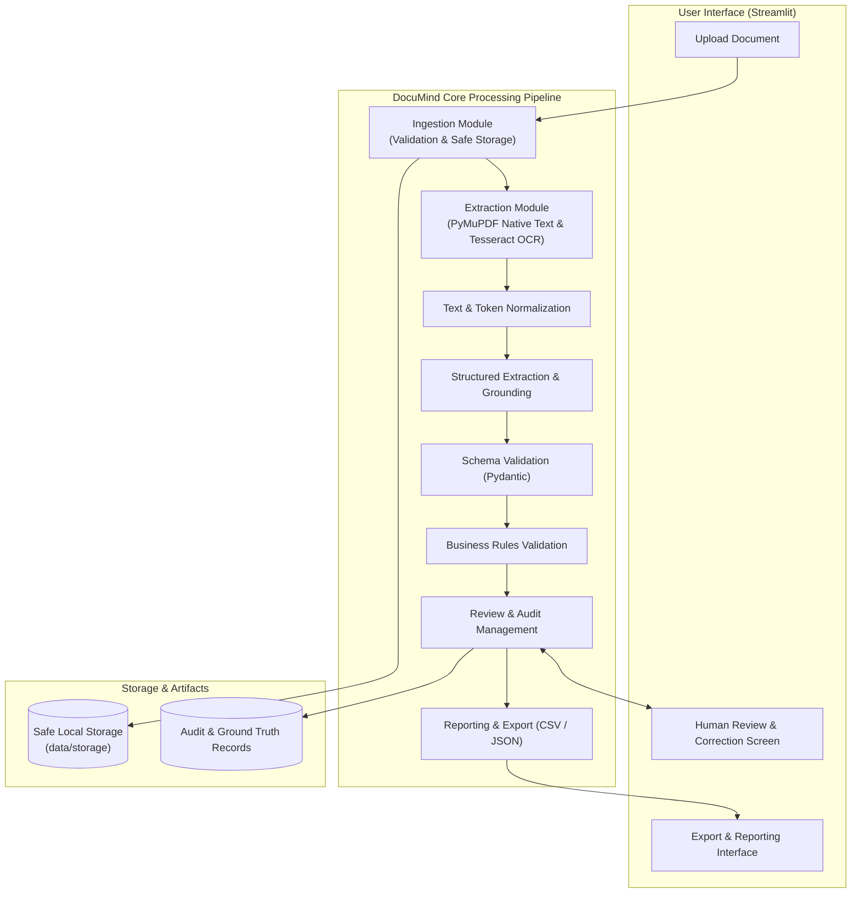
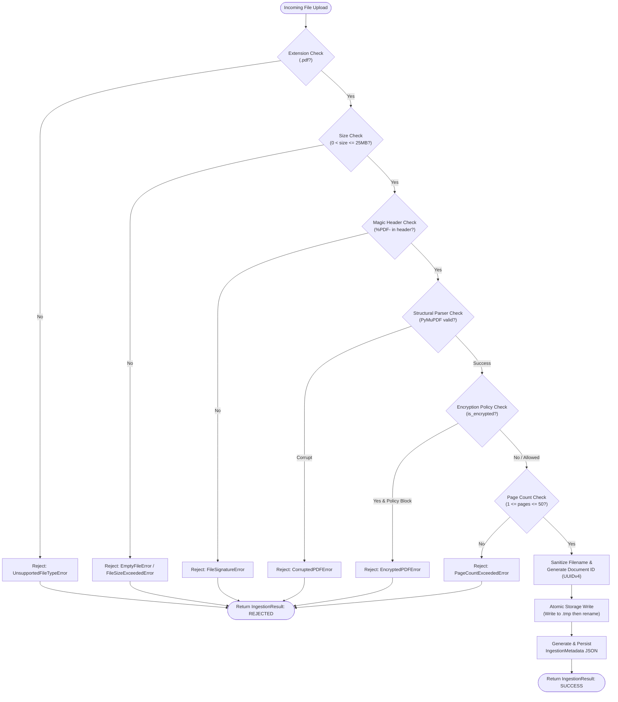

# DocuMind Architecture Specification

## 1. Overview & Vision

**DocuMind** is an intelligent document extraction and verification system specifically tailored for **invoices**. The architecture prioritizes:
- **Modularity**: Strict separation of concerns across ingestion, extraction, validation, matching, review, and reporting.
- **Robustness**: Graceful degradation from digital PDF extraction to OCR fallback.
- **Grounding & Evidence**: Every extracted value is backed by spatial provenance (bounding boxes, page numbers, raw text snippets, confidence scores).
- **Human-in-the-Loop**: Seamless review and auditability before records are committed to export.
- **Simplicity**: No premature complexity (no microservices, distributed queues, or unneeded vector databases).

---

## 2. System Architecture Diagram

---

## 3. Ingestion Subsystem Architecture (Phase 2 Implemented)

The document ingestion subsystem is implemented under `src/documind/ingestion/` and coordinates file receipt, multi-gated validation, cryptographic fingerprinting, and atomic isolated storage.

### 3.1 Ingestion Flowchart

### 3.2 Ingestion Metadata Lifecycle
1. **Reception**: Document received as raw bytes, `Path`, or binary stream.
2. **Validation**: Seven-point validation audit executed; fine-grained details recorded in `ValidationDetail`.
3. **Fingerprinting**: 64-character SHA-256 cryptographic digest computed on uncompressed raw bytes.
4. **Isolation**: File saved in `DOCUMIND_STORAGE_DIR / {document_id} / {sanitized_filename}`.
5. **Metadata Persistence**: `IngestionMetadata` is serialized to `metadata.json` alongside the stored document for instant retrieval and provenance auditing.

---

## 4. Component Responsibilities

| Component | Responsibility | Primary Technologies | Status |
| :--- | :--- | :--- | :--- |
| `documind.config` | Centralized settings, path resolution, environment variable overrides. | `pydantic-settings`, `pathlib` | **Implemented** |
| `documind.logging` | Structured, sanitized logging preventing PII leakage. | Python standard `logging` | **Implemented** |
| `documind.exceptions` | Unified hierarchical error taxonomy. | Custom Python exceptions | **Implemented** |
| `documind.dataset` | Deterministic synthetic invoice corpus generation (50 docs) & gold annotations. | `pymupdf`, `Pillow`, `pydantic` | **Implemented** |
| `documind.ingestion` | File upload validation, MIME checking, size bounds, safe unique atomic storage. | `pymupdf`, `hashlib`, standard library | **Implemented** |
| `documind.schemas` | Pydantic data models for invoice fields, evidence, and records. | `pydantic` | **Implemented** |
| `documind.validation` | Syntactic schema validation and semantic business rules (arithmetic integrity). | `pydantic`, business rule engines | Phase 4 |
| `documind.matching` | Vendor and PO reconciliation against reference records. | Fuzzy string matching, normalization | Future |
| `documind.review` | State transitions (pending, approved, rejected, corrected), audit trail logging. | Data classes, state management | Phase 5 |
| `documind.reporting` | Exporting verified invoice records to structured formats (CSV, JSON). | `pandas`, standard library `json` | Phase 6 |
| `app` | Streamlit web application providing UI for upload, verification, and inspection. | `streamlit` | Ingestion Demo Active |

---

## 5. Architectural Decisions & Rationale

- **ADR 0001**: Initial Architecture and Foundation Selection (`docs/decisions/0001-initial-architecture.md`).
- **ADR 0002**: Secure Ingestion and Synthetic Dataset Architecture (`docs/decisions/0002-ingestion-and-dataset-architecture.md`).
