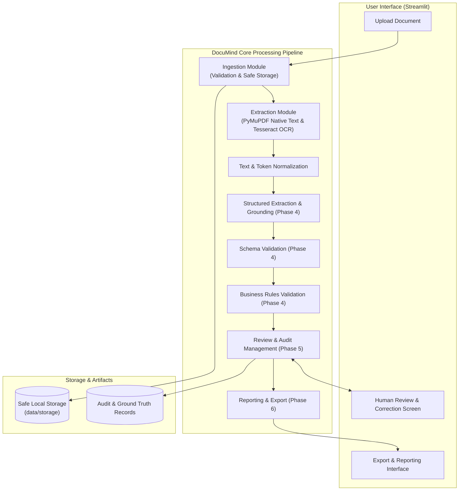

# DocuMind Architecture Specification

## 1. Overview & Vision

**DocuMind** is an intelligent document extraction and verification system specifically tailored for **invoices**. The architecture prioritizes:
- **Modularity**: Strict separation of concerns across ingestion, extraction, validation, matching, review, and reporting.
- **Robustness**: Graceful degradation from digital PDF extraction to OCR fallback.
- **Grounding & Evidence**: Every extracted value is backed by spatial provenance (bounding boxes, page numbers, raw text snippets, confidence scores).
- **Human-in-the-Loop**: Seamless review and auditability before records are committed to export.
- **Simplicity**: No premature complexity (no microservices, distributed queues, or unneeded vector databases).

---

## 2. System Architecture Diagram

---

## 3. Extraction Pipeline Architecture (Phase 3 Implemented)

The extraction engine (`src/documind/extraction/`) implements a hybrid architecture that evaluates documents on a **per-page basis** rather than assuming uniform document characteristics.

### 3.1 Extraction Result Lifecycle & Data Models
1. **`ExtractionResult`**: Top-level container recording `document_id`, `source_file_hash`, `extraction_status` (`SUCCESS`, `PARTIAL_SUCCESS`, `FAILED`), `overall_extraction_method` (`NATIVE_ONLY`, `OCR_ONLY`, `HYBRID`), `pages`, and `processing_duration_ms`.
2. **`PageExtraction`**: Page-level model containing `page_number`, `raw_text`, `normalized_text`, `text_blocks`, `word_count`, `character_count`, `page_width`, `page_height`, `quality`, and `warnings`.
3. **`SpatialTextBlock` & `SpatialWord`**: Structured tokens recording bounding box coordinates `[x0, y0, x1, y1]` in PDF points with reading order indexing.
4. **Coordinate Mapping Standard**: All coordinates conform to PDF points (`72 pt = 1 inch`) with `(0, 0)` at the top-left corner. OCR raster pixel bounding boxes are projected using dimension scaling ratios:
   $$s_x = \frac{\text{page\_width}}{\text{pixmap\_width}}, \quad s_y = \frac{\text{page\_height}}{\text{pixmap\_height}}$$

---

## 4. Component Responsibilities

| Component | Responsibility | Primary Technologies | Status |
| :--- | :--- | :--- | :--- |
| `documind.config` | Centralized settings, path resolution, environment variable overrides. | `pydantic-settings`, `pathlib` | **Implemented** |
| `documind.logging` | Structured, sanitized logging preventing PII leakage. | Python standard `logging` | **Implemented** |
| `documind.exceptions` | Unified hierarchical error taxonomy. | Custom Python exceptions | **Implemented** |
| `documind.dataset` | Deterministic synthetic invoice corpus generation (50 docs) & gold annotations. | `pymupdf`, `Pillow`, `pydantic` | **Implemented** |
| `documind.ingestion` | File upload validation, MIME checking, size bounds, safe unique atomic storage. | `pymupdf`, `hashlib`, standard library | **Implemented** |
| `documind.extraction` | Native PDF text extraction, Tesseract OCR fallback, hybrid routing, normalization. | `pymupdf`, `pytesseract`, `Pillow` | **Implemented** |
| `documind.schemas` | Pydantic data models for invoice fields, evidence, and records. | `pydantic` | **Implemented** |
| `documind.validation` | Syntactic schema validation and semantic business rules (arithmetic integrity). | `pydantic`, business rule engines | Phase 4 |
| `documind.matching` | Vendor and PO reconciliation against reference records. | Fuzzy string matching, normalization | Future |
| `documind.review` | State transitions (pending, approved, rejected, corrected), audit trail logging. | Data classes, state management | Phase 5 |
| `documind.reporting` | Exporting verified invoice records to structured formats (CSV, JSON). | `pandas`, standard library `json` | Phase 6 |
| `app` | Streamlit web application providing UI for upload, verification, and inspection. | `streamlit` | Ingestion & Extraction Demo Active |

---

## 5. Architectural Decisions & Rationale

- **ADR 0001**: Initial Architecture and Foundation Selection (`docs/decisions/0001-initial-architecture.md`).
- **ADR 0002**: Secure Ingestion and Synthetic Dataset Architecture (`docs/decisions/0002-ingestion-and-dataset-architecture.md`).
- **ADR 0003**: Hybrid PDF Text Extraction & OCR Pipeline (`docs/decisions/0003-extraction-pipeline.md`).
