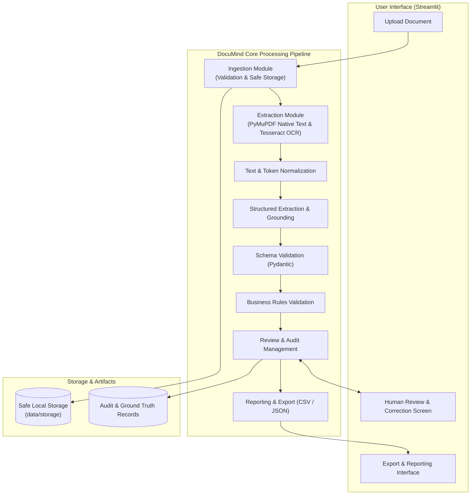
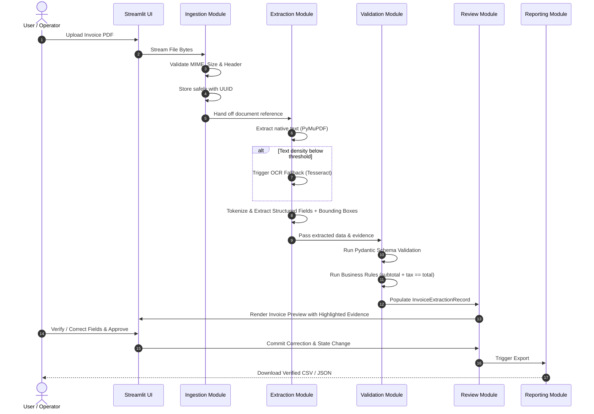

# DocuMind Architecture Specification

## 1. Overview & Vision

**DocuMind** is an intelligent document extraction and verification system specifically tailored for **invoices**. The architecture prioritizes:
- **Modularity**: Strict separation of concerns across ingestion, extraction, validation, matching, review, and reporting.
- **Robustness**: Graceful degradation from digital PDF extraction to OCR fallback.
- **Grounding & Evidence**: Every extracted value is backed by spatial provenance (bounding boxes, page numbers, raw text snippets, confidence scores).
- **Human-in-the-Loop**: Seamless review and auditability before records are committed to export.
- **Simplicity**: No premature complexity (no microservices, distributed queues, or unneeded vector databases).

---

## 2. System Architecture Diagram

---

## 3. Component Responsibilities

| Component | Responsibility | Primary Technologies |
| :--- | :--- | :--- |
| `documind.config` | Centralized settings, path resolution, environment variable overrides. | `pydantic-settings`, `pathlib` |
| `documind.logging` | Structured, sanitized logging preventing PII leakage. | Python standard `logging` |
| `documind.exceptions` | Unified hierarchical error taxonomy. | Custom Python exceptions |
| `documind.ingestion` | File upload validation, MIME checking, size bounds, safe unique storage. | Python standard library, `hashlib` |
| `documind.extraction` | PDF text parsing, fallback to OCR on image-heavy/scanned pages, token grounding. | `pymupdf` (fitz), `pytesseract`, `Pillow` |
| `documind.schemas` | Pydantic data models for invoice fields, evidence, and records. | `pydantic` |
| `documind.validation` | Syntactic schema validation and semantic business rules (arithmetic integrity). | `pydantic`, business rule engines |
| `documind.matching` | Vendor and PO reconciliation against reference records. | Fuzzy string matching, normalization |
| `documind.review` | State transitions (pending, approved, rejected, corrected), audit trail logging. | Data classes, state management |
| `documind.reporting` | Exporting verified invoice records to structured formats (CSV, JSON). | `pandas`, standard library `json` |
| `app` | Streamlit web application providing UI for upload, verification, and inspection. | `streamlit` |

---

## 4. Processing Pipeline & Data Flow

---

## 5. Architectural Decisions & Rationale

### ADR-01: Modular Monolith vs. Distributed Microservices
- **Decision**: Implement DocuMind as a clean, modular Python monolith.
- **Rationale**: For document extraction and verification workflows at this stage, microservices introduce excessive network latency, deployment overhead, and serialization costs without architectural justification. In-process function calls allow direct passing of rich memory structures (e.g. bounding box matrices and PyMuPDF page objects).

### ADR-02: PyMuPDF for Native Digital PDF Extraction
- **Decision**: Use `pymupdf` (MuPDF C bindings) for native text and coordinate extraction.
- **Rationale**: PyMuPDF is orders of magnitude faster than pure Python alternatives (like `pypdf`), delivers precise character- and word-level bounding boxes, handles complex font encodings accurately, and renders high-fidelity page images for OCR.

### ADR-03: Tesseract OCR as Local Fallback Engine
- **Decision**: Integrate Tesseract via `pytesseract` as an on-premise, privacy-safe OCR fallback.
- **Rationale**: Keeps the pipeline fully offline and self-contained, avoiding vendor lock-in or recurring cloud API costs while maintaining zero external data leakage for confidential invoice documents.

### ADR-04: Two-Tier Validation (Schema + Business Rules)
- **Decision**: Separate structural schema compliance (types, lengths, required fields) from domain business logic (arithmetic relationships, date boundaries).
- **Rationale**: Structural failures indicate extraction parsing faults, whereas business rule discrepancies highlight actual invoice disputes or arithmetic issues requiring human review.
