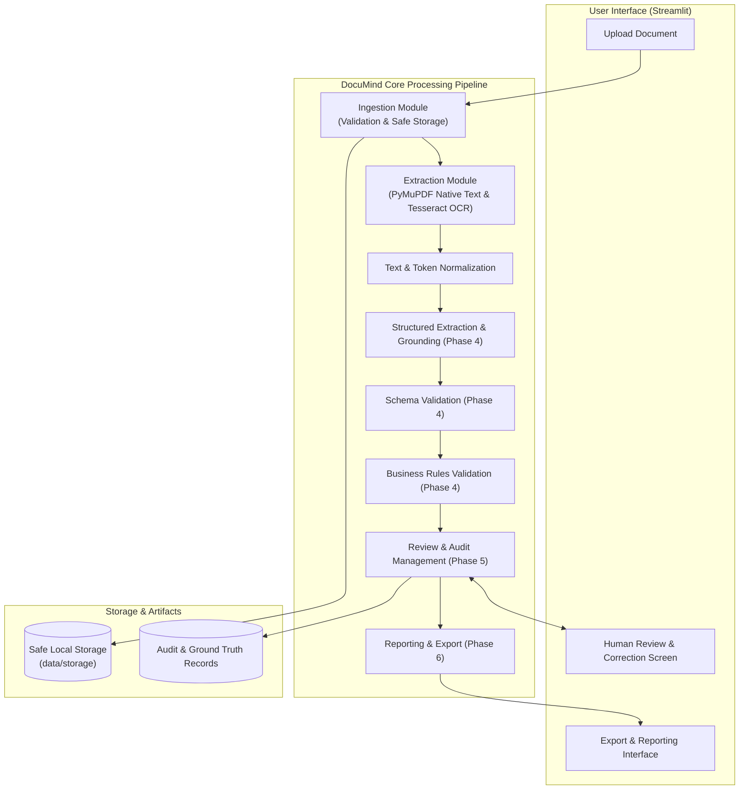
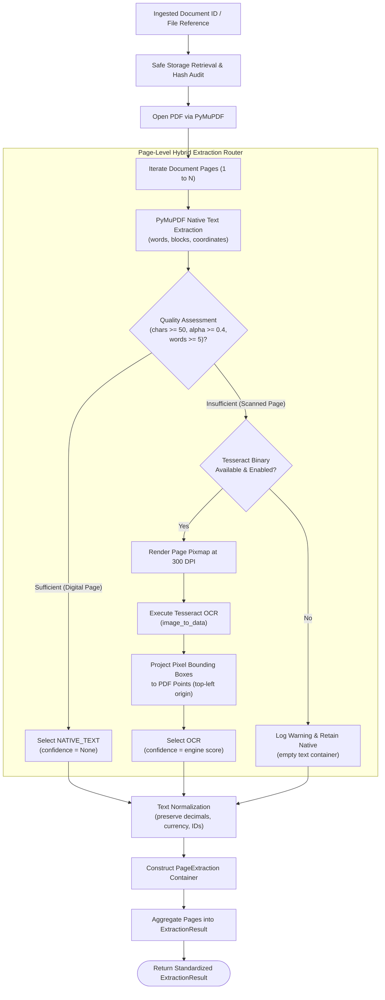
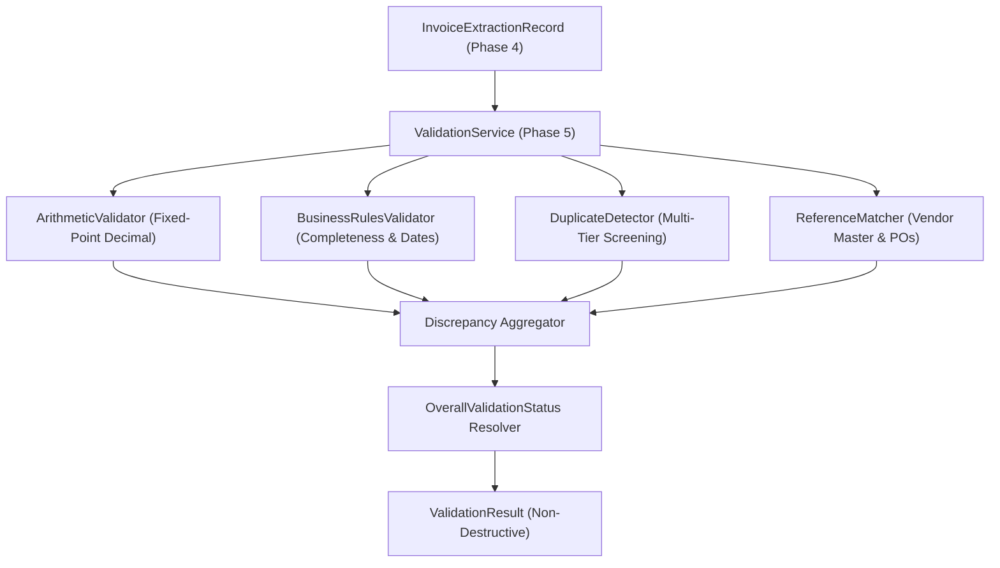
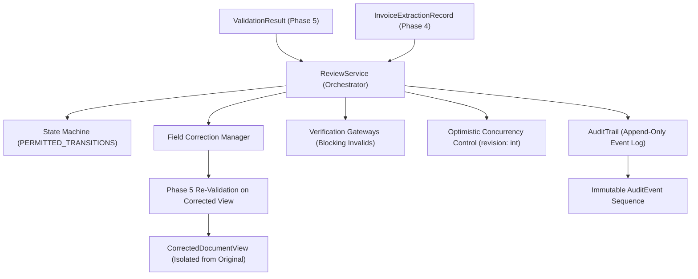

# DocuMind Architecture Specification

## 1. Overview & Vision

**DocuMind** is an intelligent document extraction and verification system specifically tailored for **invoices**. The architecture prioritizes:
- **Modularity**: Strict separation of concerns across ingestion, extraction, validation, matching, review, and reporting.
- **Robustness**: Graceful degradation from digital PDF extraction to OCR fallback.
- **Grounding & Evidence**: Every extracted value is backed by spatial provenance (bounding boxes, page numbers, raw text snippets, confidence scores).
- **Human-in-the-Loop**: Seamless review and auditability before records are committed to export.
- **Simplicity**: No premature complexity (no microservices, distributed queues, or unneeded vector databases).

---

## 2. System Architecture Diagram



---

## 3. Extraction Pipeline Architecture (Phase 3 Implemented)

The extraction engine (`src/documind/extraction/`) implements a hybrid architecture that evaluates documents on a **per-page basis** rather than assuming uniform document characteristics.



### 3.1 Extraction Result Lifecycle & Data Models
1. **`ExtractionResult`**: Top-level container recording `document_id`, `source_file_hash`, `extraction_status` (`SUCCESS`, `PARTIAL_SUCCESS`, `FAILED`), `overall_extraction_method` (`NATIVE_ONLY`, `OCR_ONLY`, `HYBRID`), `pages`, and `processing_duration_ms`.
2. **`PageExtraction`**: Page-level model containing `page_number`, `raw_text`, `normalized_text`, `text_blocks`, `word_count`, `character_count`, `page_width`, `page_height`, `quality`, and `warnings`.
3. **`SpatialTextBlock` & `SpatialWord`**: Structured tokens recording bounding box coordinates `[x0, y0, x1, y1]` in PDF points with reading order indexing.
4. **Coordinate Mapping Standard**: All coordinates conform to PDF points (`72 pt = 1 inch`) with `(0, 0)` at the top-left corner. OCR raster pixel bounding boxes are projected using dimension scaling ratios:
   $$s_x = \frac{\text{page\_width}}{\text{pixmap\_width}}, \quad s_y = \frac{\text{page\_height}}{\text{pixmap\_height}}$$

---

### 3.2 Business Validation & Discrepancy Architecture (Phase 5)



The validation layer guarantees:
1. **Fixed-Point Precision**: Financial comparisons use Python `Decimal` with half-up cent precision, avoiding floating-point rounding errors.
2. **Deterministic Discrepancy Models**: Findings include rule ID, category, severity, affected fields, expected/actual values, difference, human-readable explanations, and spatial evidence references.
3. **Multi-Tier Duplicate Screening**: Detects exact file hash duplicates (`DUP_000`), exact vendor-invoice duplicates (`DUP_001`), potential duplicates (`DUP_002`), and cross-vendor collisions (`DUP_003`).
4. **Non-Destructive Execution**: Validation outputs audit objects without mutating original extraction records or dropping files.

### 3.3 Human Review Workflow & Audit Trail Architecture (Phase 6)



The review architecture guarantees:
1. **Strict Data Isolation**: Original extraction records and spatial bounding-box evidence are immutable.
2. **Deterministic State Machine**: 6 states (`PENDING`, `IN_REVIEW`, `CORRECTION_REQUESTED`, `APPROVED`, `REJECTED`, `RETURNED_FOR_REVIEW`) with rejection of invalid transitions.
3. **Verification Gateways**: Prevents approving documents with unresolved critical discrepancies or invalid states until corrected.
4. **Append-Only Audit Trail**: Every decision, correction, assignment, and state transition produces an immutable `AuditEvent`.

### 3.4 Streamlit Presentation & Reporting Architecture (Phase 7)

```mermaid
flowchart TD
    Browser["User Browser (Streamlit Multipage App)"] --> AppState["AppState Singleton Coordinator"]
    
    subgraph UI Pages
        P0["Home (Diagnostics & Overview)"]
        P1["01 Dashboard (AP KPIs & Trends)"]
        P2["02 Upload Invoices (Multi-Gate Portal)"]
        P3["03 Document Explorer (Registry & Drawers)"]
        P4["04 Review Workbench (Split-Screen Evidence & Gateways)"]
        P5["05 Validation Reports (Rule Hit Rates)"]
        P6["06 Audit History (Immutable Event Stream)"]
        P7["07 Settings & Export (Corpus Loader & Reports)"]
    end
    
    Browser --- UI Pages
    UI Pages --> AppState
    
    AppState --> Ingestion["IngestionService"]
    AppState --> Extraction["ExtractionService + StructuredExtractor"]
    AppState --> Validation["ValidationService"]
    AppState --> Review["ReviewService"]
    AppState --> Audit["AuditTrail"]
    AppState --> Reporting["Reporting Exporters (CWE-1236 Sanitization)"]
    
    AppState --> LocalStorage[("Local JSON State Persistence<br/>data/storage/app_state/")]
```

The presentation layer guarantees:
1. **Zero Fake Metrics**: All dashboard KPIs, discrepancy metrics, and status breakdowns are derived live from active domain records.
2. **Dynamic Evidence Grounding**: High-DPI rasterization with automatic conversion from PDF point coordinates to pixel space and amber bounding-box highlight overlays.
3. **Approval Gateways**: Prevents approving documents with unresolved critical discrepancies.
4. **Formula Injection Sanitization**: Tabular CSV exports neutralize spreadsheet injection vectors by prefixing dangerous characters with single quotes.

---

## 4. Component Responsibilities

| Component | Responsibility | Primary Technologies | Status |
| :--- | :--- | :--- | :--- |
| `documind.config` | Centralized settings, path resolution, environment variable overrides. | `pydantic-settings`, `pathlib` | **Implemented** |
| `documind.logging` | Structured, sanitized logging preventing PII leakage. | Python standard `logging` | **Implemented** |
| `documind.exceptions` | Unified hierarchical error taxonomy. | Custom Python exceptions | **Implemented** |
| `documind.dataset` | Deterministic synthetic invoice corpus generation (50 docs) & gold annotations. | `pymupdf`, `Pillow`, `pydantic` | **Implemented** |
| `documind.ingestion` | File upload validation, MIME checking, size bounds, safe unique atomic storage. | `pymupdf`, `hashlib`, standard library | **Implemented** |
| `documind.extraction` | Native PDF text extraction, Tesseract OCR fallback, hybrid routing, normalization. | `pymupdf`, `pytesseract`, `Pillow` | **Implemented** |
| `documind.schemas` | Pydantic data models for invoice fields, line items, evidence, and records. | `pydantic` | **Implemented** |
| `documind.validation` | Deterministic business validation: arithmetic integrity, completeness, duplicate detection, reference matching. | `Decimal`, Pydantic models, string distance | **Implemented** |
| `documind.matching` | Vendor and PO reconciliation against reference records (integrated in `documind.validation`). | Exact & normalized matching | **Implemented** |
| `documind.review` | Human review lifecycle, non-destructive field corrections, verification gateways, append-only audit trail. | Finite state machines, Pydantic, optimistic locking | **Implemented** |
| `documind.reporting` | Exporting verified invoice records to structured formats (CSV, JSON) with formula injection protection. | Python standard library `csv`, `json`, CWE-1236 sanitizer | **Implemented** |
| `app` | Streamlit multipage application providing UI for dashboard, upload, review workbench, audit history, and reports. | `streamlit`, `pymupdf`, `Pillow` | **Implemented** |

---

## 5. Architectural Decisions & Rationale

- **ADR 0001**: Initial Architecture and Foundation Selection (`docs/decisions/0001-initial-architecture.md`).
- **ADR 0002**: Secure Ingestion and Synthetic Dataset Architecture (`docs/decisions/0002-ingestion-and-dataset-architecture.md`).
- **ADR 0003**: Hybrid PDF Text Extraction & OCR Pipeline (`docs/decisions/0003-extraction-pipeline.md`).
- **ADR 0004**: Structured Invoice Field Extraction & Evidence Grounding (`docs/decisions/0004-structured-extraction-and-evidence-mapping.md`).
- **ADR 0005**: Deterministic Business Rule Validation, Arithmetic Consistency & Discrepancy Detection (`docs/decisions/0005-business-rule-validation-and-discrepancies.md`).
- **ADR 0006**: Human Review Workflow, Non-Destructive Corrections & Append-Only Audit Trail (`docs/decisions/0006-human-review-and-audit-trail.md`).
- **ADR 0007**: Streamlit Application Architecture, Evidence Highlighting & Auditable Reporting (`docs/decisions/0007-streamlit-application-and-reporting.md`).
