# DocuMind Privacy & Security Architecture

DocuMind processes financial invoices, which regularly contain confidential corporate information, pricing structures, and Personally Identifiable Information (PII) such as personal addresses, bank details, and contact numbers. This document details the privacy and security principles enforced across the system.

---

## 1. Synthetic-Data-First Policy

To eliminate legal, regulatory (GDPR, CCPA, HIPAA), and data breach risks during development, testing, and continuous integration:

- **Strict Ban on Real Documents in Source Control**: No real customer or production invoices may be committed to git or stored in public test suites.
- **Programmatic Generation**: All test corpora, benchmark fixtures, and demonstration files are generated synthetically via programmatic templates (using `PyMuPDF`, `Pillow`, and synthetic business entity profiles).
- **Safe Directory Quarantine**: The `data/storage/` and `data/uploads/` runtime directories are explicitly excluded in `.gitignore`.

---

## 2. File Upload & Ingestion Security

File uploads represent a critical attack surface (e.g. zip/PDF bombs, embedded scripts, path traversal exploits, executable masquerading). Ingestion applies multi-layered defenses:

```mermaid
flowchart LR
    Upload["User Upload"] --> SizeCheck["Size Limit Check<br/>(<= 25MB)"]
    SizeCheck --> MIMECheck["Extension Check<br/>(.pdf)"]
    MIMECheck --> MagicCheck["Magic Bytes Verification<br/>(%PDF- in header)"]
    MagicCheck --> ParserCheck["Structural Integrity Check<br/>(PyMuPDF parsing)"]
    ParserCheck --> EncryptCheck["Encryption Check<br/>(Policy enforcement)"]
    EncryptCheck --> PageCheck["Page Ceiling Check<br/>(<= 50 pages)"]
    PageCheck --> Sanitization["Filename Sanitization<br/>(Path Traversal Prevention)"]
    Sanitization --> IsolatedStore["UUID-Isolated Atomic Storage"]
```

### 2.1 File Validation Controls
1. **Extension Enforcement**: Only `.pdf` files are permitted.
2. **Binary Signature Verification**: The binary stream is checked for the `%PDF-` header signature within the first 1024 bytes. Plain text, HTML, or executables disguised as `.pdf` are rejected immediately.
3. **Strict File Size Bounds**: Enforced 25MB default ceiling (`DOCUMIND_MAX_UPLOAD_SIZE_MB`) prevents memory exhaustion and denial-of-service (DoS) conditions.
4. **Page Count Ceilings**: Documents exceeding `DOCUMIND_MAX_PAGE_COUNT` (default: 50 pages) are rejected to prevent computational denial-of-service during extraction.
5. **Encryption Policy**: Encrypted or password-protected PDFs are rejected by default (`DOCUMIND_ALLOW_ENCRYPTED_PDFS=false`) to avoid opaque extraction crashes and unvetted ciphertext processing.

### 2.2 Storage Controls & Path Traversal Prevention
1. **Filename Sanitization**: Client-supplied filenames are sanitized:
   - Basenames only (directory separators `/` and `\` stripped).
   - Relative path traversal sequences (`..`) purged.
   - Non-alphanumeric symbols replaced with safe underscores.
   - Fallback to `document.pdf` if input is blank or dots.
2. **Isolated Storage Hierarchy**:
   Every document is allocated a dedicated UUIDv4 folder:
   $$\text{Storage Path} = \text{DOCUMIND\_STORAGE\_DIR} / \text{UUIDv4} / \text{sanitized\_filename.pdf}$$
3. **Atomic Writes**: Content is initially written to a `.tmp` file, synced to disk (`os.fsync`), and atomically replaced (`Path.replace`). If an error occurs, the temporary file is deleted, ensuring no partially written or corrupted files persist.

---

## 3. Storage Considerations & Data Retention

- **Ephemeral by Default**: In production or multi-tenant deployments, raw PDFs should be retained only for the duration of the processing and review lifecycle.
- **Non-Public Storage**: The `data/storage/` directory is isolated outside public static asset folders and web-accessible document roots.
- **Access Restrictions**: Stored files are written with restricted file permissions (`chmod 0600` on POSIX environments).

---

## 4. Sensitive Information & Logging Restrictions

- **Zero-PII Logging Principle**: Log messages must never output full raw text streams, bank account numbers, tax identification numbers, or user credit card details.
- **Metadata-Only Logging**: Logging statements record document identifiers, processing timings, status transitions, and error codes:
  * ✅ *Good*: `Stored document id=f47ac10b-58cc-4372-a567-0e02b2c3d479 size=142KB at data/storage/...`
  * ❌ *Prohibited*: `Parsed text: "Vendor John Doe Bank IBAN US123456789 Total $1,200"`
- **Sanitized Exception Handling**: Uncaught exceptions bubble up clean diagnostic messages rather than raw document buffers.

---

## 5. Residual Security Risks & Future Hardening

While the current multi-stage validation provides strong defense-in-depth, certain residual risks inherent to PDF parsing exist:

1. **Underlying C-Parser Vulnerabilities**: PyMuPDF relies on MuPDF (C library). Complex or maliciously crafted PDF constructs (e.g. deeply nested object streams, circular cross-reference tables) could theoretically trigger C-level memory corruption or crashes.
   * *Mitigation for Untrusted Public Deployments*: Run the ingestion and extraction service in an unprivileged, isolated sandbox (e.g. gVisor, Docker container with seccomp/AppArmor profiles, or read-only ephemeral microVM).
2. **Decompression Bombs (Zip/PDF FlateBombs)**: Heavily compressed streams that expand to gigabytes upon decompression.
   * *Mitigation*: PyMuPDF sets internal stream expansion ceilings; additional memory monitoring should be introduced if multi-gigabyte batch processing is enabled.
3. **External Transmission Safeguards**: The system operates completely offline. No document payload is ever transmitted over third-party networks or external LLM APIs.
