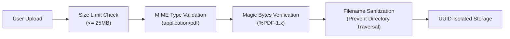

# DocuMind Privacy & Security Architecture

DocuMind processes financial invoices, which regularly contain confidential corporate information, pricing structures, and Personally Identifiable Information (PII) such as personal addresses, bank details, and contact numbers. This document details the privacy and security principles enforced across the system.

---

## 1. Synthetic-Data-First Policy

To eliminate legal, regulatory (GDPR, CCPA, HIPAA), and data breach risks during development, testing, and continuous integration:

- **Strict Ban on Real Documents in Source Control**: No real customer or production invoices may be committed to git or stored in public test suites.
- **Programmatic Generation**: All test corpora, benchmark fixtures, and demonstration files must be generated synthetically via programmatic templates (e.g., using `ReportLab`, synthetic data generators, and fictitious company profiles).
- **Safe Directory Quarantine**: The `data/storage/` and `data/uploads/` runtime directories are explicitly excluded in `.gitignore`.

---

## 2. File Upload & Ingestion Security

File uploads represent an attack vector (e.g. zip bombs, embedded PDF malware, executable scripts). Ingestion applies multi-layered defenses:

1. **Strict File Size Bounds**: Enforced 25MB default ceiling (`DOCUMIND_MAX_UPLOAD_SIZE_MB`) prevents memory exhaustion and denial-of-service (DoS) conditions.
2. **MIME & Magic Bytes Inspection**: Ingestion verifies both the declared MIME type and the binary header magic bytes (`%PDF-`). File extension spoofing (e.g., `invoice.pdf.exe`) is rejected.
3. **Path Traversal Protection**: Filenames submitted by clients are sanitized using standard basename isolation and stored under randomly generated UUIDs:
   $$\text{Storage Path} = \text{DOCUMIND\_STORAGE\_DIR} / \text{UUIDv4} / \text{safe\_name.pdf}$$
   Relative sequence elements such as `../` or `..\\` are stripped entirely.

---

## 3. Storage Considerations & Data Retention

- **Ephemeral by Default**: In production or multi-tenant deployments, raw PDFs should be retained only for the duration of the processing and review lifecycle.
- **Access Restrictions**: Stored files are written with restricted file permissions (`chmod 0600` on POSIX environments).
- **Data Segregation**: Workspaces and ingested files are segregated by document identifier to prevent cross-document data leakage.

---

## 4. Sensitive Information & Logging Restrictions

- **Zero-PII Logging Principle**: Log messages must never output full raw text streams, bank account numbers, tax identification numbers, or user credit card details.
- **Metadata-Only Logging**: Logging statements record document identifiers, processing timings, status transitions, and error codes:
  * ✅ *Good*: `Ingested document id=f47ac10b... size=142KB pages=2`
  * ❌ *Prohibited*: `Parsed text: "Vendor John Doe Bank IBAN US123456789 Total $1,200"`
- **Sanitized Exception Handling**: Uncaught exceptions bubble up clean diagnostic messages rather than raw document buffers.

---

## 5. External OCR & LLM Privacy Considerations

- **Local-First Execution**: The default extraction pipeline relies on local C-libraries (`PyMuPDF` and local `Tesseract`), ensuring zero document data leaves the host environment or crosses third-party networks.
- **Future Third-Party LLM Policy**: If external cloud language models or remote vision APIs are evaluated in future phases:
  * Strict user opt-in must be required before any external transmission.
  * PII masking and redaction must be performed before payload dispatch.
  * Zero-data-retention (ZDR) commercial agreements must be verified before connecting enterprise endpoints.
