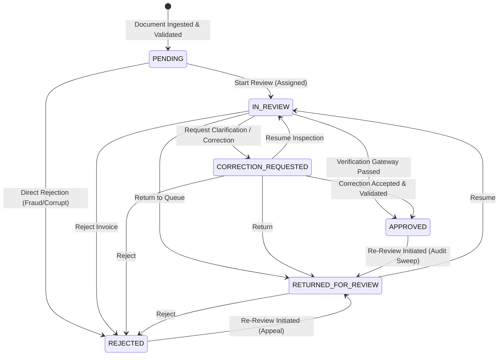

# DocuMind Phase 6 — Human Review Workflow & Audit Trail Evaluation Report

**Evaluation Date**: 2026-11-08  
**DocuMind Version**: 0.1.0  
**Phase Scope**: Human Review Domain Architecture, State Machine, Non-Destructive Field Corrections, Verification Gateways, Optimistic Concurrency, and Append-Only Audit Trail  

---

## 1. Executive Summary & Verification Verdict

Phase 6 implements the complete domain and workflow subsystem for human-in-the-loop invoice review in DocuMind. The subsystem consumes structured extraction records from Phase 4 and validation results from Phase 5, providing accounts payable reviewers with structured capabilities to inspect extracted fields, examine supporting evidence, submit field corrections, record decisions, and approve or reject documents.

The implementation strictly enforces non-destructive data handling: original extractions and bounding-box evidence are never overwritten or mutated. Accepted corrections are synthesized into an isolated `CorrectedDocumentView`, which automatically re-runs Phase 5 business validation to prevent the approval of mathematically inconsistent or incomplete documents.

### Verification Matrix

| Component / Requirement | Target Behavior | Verified Outcome | Verdict |
| :--- | :--- | :--- | :---: |
| **Review Lifecycle State Machine** | 6 states (`PENDING`, `IN_REVIEW`, `CORRECTION_REQUESTED`, `APPROVED`, `REJECTED`, `RETURNED_FOR_REVIEW`) | Invalid transitions rejected; re-review supported | ✅ **PASS** |
| **Field Corrections** | Non-destructive proposals, superseding, acceptance & rejection | Original extractions untouched; full history preserved | ✅ **PASS** |
| **Verification Gateways** | Block approval on `INVALID` or unresolved `NEEDS_REVIEW` | Missing mandatory fields strictly block approval until corrected | ✅ **PASS** |
| **Re-Validation on Correction** | Re-run Phase 5 validation on corrected representations | Mathematical fixes clear arithmetic discrepancies | ✅ **PASS** |
| **Evidence Grounding** | Ground corrections in real evidence; flag manual entries honestly | No fabricated bounding boxes; `is_reviewer_supplied=True` | ✅ **PASS** |
| **Append-Only Audit Trail** | Immutable chronological event log with actor attribution | Frozen events; append-only enforcement; no silent edits | ✅ **PASS** |
| **Optimistic Concurrency** | Reject stale revision updates; block duplicate active reviews | `ReviewConcurrencyError` & `DuplicateActiveReviewError` | ✅ **PASS** |

---

## 2. Review Lifecycle & State Transition Model

### State Machine Transition Rules
- **Direct PENDING to APPROVED**: Strictly prohibited. Every document must be actively inspected (`IN_REVIEW`) before approval.
- **Terminal States**: `APPROVED` and `REJECTED` close the active review. Initiating a re-review transitions the document to `RETURNED_FOR_REVIEW` and records a `REREVIEW_INITIATED` audit event.
- **Duplicate Protection**: A document cannot have more than one active (non-terminal) review simultaneously (`DuplicateActiveReviewError`).

---

## 3. Field Correction & Version Management

Phase 6 enforces a four-tier separation of concerns:
1. **Original Extraction**: Unmodified `InvoiceExtractionRecord` with original raw strings, numbers, and native/OCR spatial bounding boxes.
2. **Reviewer Proposals**: Immutable `FieldCorrection` records capturing proposed value, mandatory rationale (minimum 3 characters), author, and timestamp.
3. **Accepted Corrections**: Active corrections approved by reviewers. Superseded and rejected corrections are retained in the review record for historical comparison.
4. **Corrected Document View**: Synthesized representation combining original fields with accepted corrections, paired with a newly evaluated `ValidationResult`.

### Evidence Grounding Integrity
- Corrections that cite document text must supply valid `evidence_references` existing in the document's original evidence dictionary. Invalid references raise `InvalidCorrectionError`.
- For reviewer-supplied values without source document backing (e.g. manual PO numbers or vendor codes), the system marks `is_reviewer_supplied = True` with `bounding_box = None`. No coordinates are ever fabricated.

---

## 4. Verification Gateways & Re-Validation

Approval is governed by deterministic business gateways:
- **`OverallValidationStatus.INVALID`**: Documents missing mandatory fields (e.g. `DOC-SYN-007` missing invoice number) cannot be approved. The reviewer must submit and accept a correction providing the missing field. Once accepted, re-validation evaluates to `VALID`, enabling approval.
- **`OverallValidationStatus.NEEDS_REVIEW`**: Documents with arithmetic mismatches (e.g. `DOC-SYN-015` where printed total was \$1766 vs calculated \$1716) cannot be approved under standard reason codes. The reviewer must either:
  1. Submit an accepted correction resolving the arithmetic discrepancy (transitioning the corrected status to `VALID`), OR
  2. Provide an authorized `OVERRIDE` reason code with an explanatory comment (e.g., contractual discount approved by finance).
- **`OverallValidationStatus.VALID_WITH_WARNINGS`**: Allowed to proceed to approval upon reviewer acknowledgment of informational notices.
- **`OverallValidationStatus.VALID`**: Clean documents proceed straight to approval.

---

## 5. Append-Only Audit Trail Architecture

The `AuditTrail` records chronological workflow events:
- Event Types: `REVIEW_CREATED`, `REVIEW_ASSIGNED`, `REVIEW_STARTED`, `DECISION_SUBMITTED`, `CORRECTION_PROPOSED`, `CORRECTION_ACCEPTED`, `CORRECTION_REJECTED`, `REVIEW_RETURNED`, `DOCUMENT_APPROVED`, `DOCUMENT_REJECTED`, `REREVIEW_INITIATED`.
- Each event stores: `event_id`, `document_id`, `review_id`, `actor`, `timestamp`, `previous_state`, `new_state`, `affected_fields`, `discrepancy_ids`, and structured `details`.

### Audit Integrity Guarantees & Limitations
- **Guarantees**: Events are modeled as frozen Pydantic instances. Historical events cannot be edited or deleted through application interfaces. If an event requires clarification, a subsequent explanatory event must be appended.
- **Limitations**: Immutability is enforced at the domain and application level in Python memory and serialized storage. DocuMind does not claim hardware WORM storage, operating-system-level write protection, or blockchain cryptographic tamper-proofing.

---

## 6. Concurrency Safeguards

- **Optimistic Concurrency**: Every `ReviewRecord` includes a monotonically increasing `revision: int`. Mutating calls accept an `expected_revision` argument; any attempt to apply updates against a stale revision raises `ReviewConcurrencyError`.
- **Atomic Rollback**: If an operation fails during execution (e.g., validation gateway rejection or invalid state transition), review state is not mutated, and no spurious audit events are appended.
